# Earth Games

*(dépôt « steam-earth » : ancien nom de travail)*

Prototype Godot 4.7 (C#) : **la Terre entière, ronde, à l'échelle 1:1**, avec son relief réel.
On peut aller de la marche à pied jusqu'à l'orbite sans changer de scène.

| Interlaken (lacs de Thoune et Brienz) | Vers le Cervin | Europe depuis 3 000 km |
|---|---|---|
| 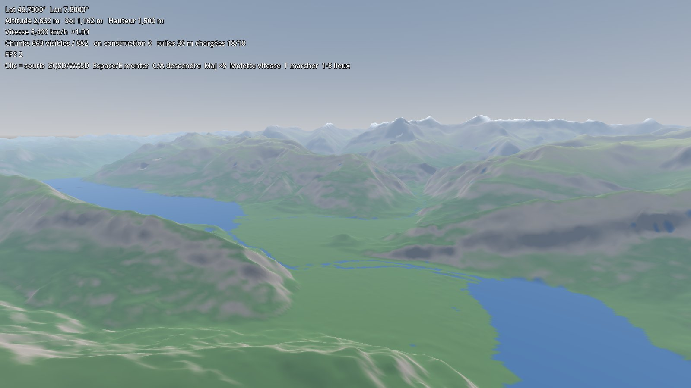 | 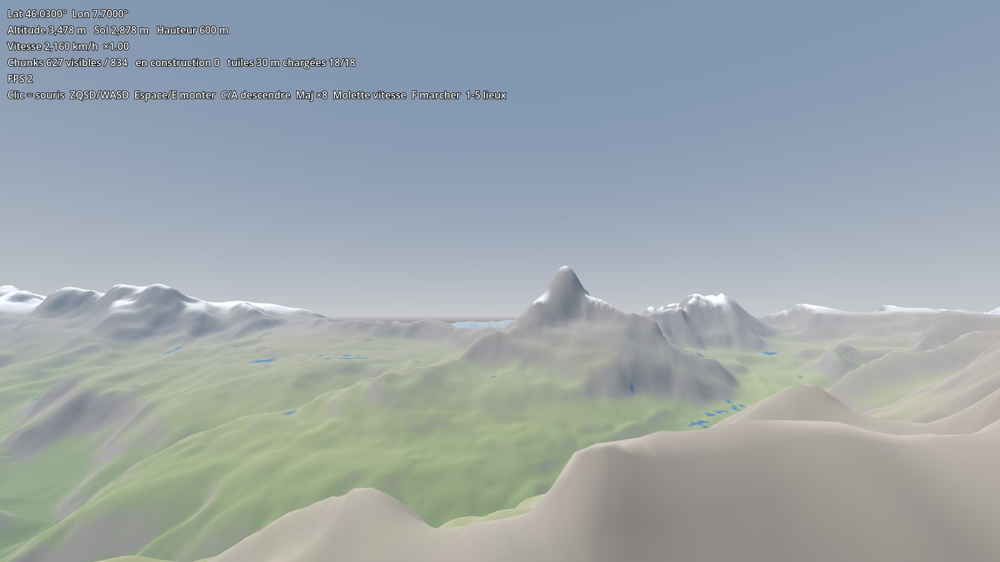 | 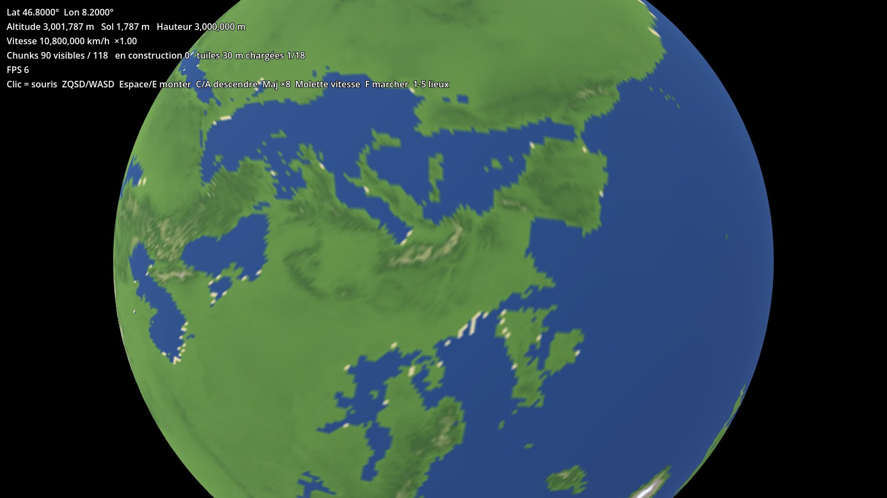 |

## Lancer le projet

1. Installer **Godot 4.7.2 .NET** et le **SDK .NET 8**.
2. Cloner ce dépôt, puis dans Godot : *Importer* → choisir `project.godot`.
3. Appuyer sur **F5**. Au premier lancement, Godot compile le C#.

Le jeu s'ouvre sur l'**écran titre** (la Terre tourne derrière le menu) : *Jouer* mène au choix du lieu de départ,
*Options* règle les graphismes, la langue (français / anglais), la taille de l'interface, le plein écran, les unités,
la sensibilité de la souris. En jeu, un HUD discret montre la vitesse, l'altitude, l'heure locale et la météo réelle,
avec une boussole en haut.

### Commandes

| Touche | Action |
|---|---|
| Échap | menu pause (le jeu s'arrête) : reprendre, changer de lieu, options, commandes, crédits, menu principal, quitter |
| F1 | liste des commandes (les lettres suivent la disposition du clavier : Z Q S D en AZERTY) |
| F2 / F3 | masquer le HUD / informations techniques (chunks, téléchargements, météo détaillée…) |
| F11 | plein écran |
| Clic gauche / Alt maintenu | capturer la souris / la libérer (pour cliquer sur un nom de ville) |
| Z Q S D (W A S D en QWERTY) | se déplacer |
| Espace ou E / C ou A | monter / descendre |
| Maj | vitesse ×8 |
| Molette | multiplicateur de vitesse |
| F | mode marche avec un personnage : gravité vers le centre de la Terre, Espace = sauter, Maj = courir, X = marcher tranquillement, C = s'accroupir ; il nage dans l'eau |
| V (en marche) | vue arrière (caméra derrière le personnage) / vue à la première personne (on voit son corps) |
| U | menu Personnage : qui on incarne, coiffure, tenue (voir `docs/PERSONNAGE.md`) |
| I | Suisse : parler au passant le plus proche, voir son histoire (voir `docs/POPULATION.md`) |
| G | menu des véhicules : 16 véhicules en 4 catégories (il apparaît devant toi et tu montes dedans) |
| E (à pied / en véhicule) | monter dans le véhicule le plus proche / en descendre (à l'arrêt) |
| Souris / molette (en marche) | tourner la caméra autour du personnage / la rapprocher ou l'éloigner |
| 1 à 9 | Interlaken, Zermatt, Léman, Europe vue de l'espace, Himalaya, New York, Tokyo, Sydney, Rio |
| + / − (Maj : par ¼ h) | avancer / reculer l'heure (test) |
| R | revenir à l'heure réelle |
| J | jour permanent : le soleil reste haut partout (l’heure et la météo restent réelles ; réglage mémorisé) |
| Tab (ou bouton « Pays ») | menu des pays : clic = 500 m au-dessus de la capitale, recherche par nom |
| B | afficher / masquer frontières et capitales |
| T | afficher / masquer routes, chemins et voies ferrées |
| N | afficher / masquer les noms des villes, villages et rues |
| P | afficher / masquer les transports : gares, arrêts, débarcadères, aéroports |
| H | près d'un arrêt en Suisse : tableau des départs (1–9 choisir, ↑/↓ plus tard) ; en voyage : descendre au prochain arrêt |
| M | menu de départ : reprendre, chercher une ville du monde, ou cliquer sur la Terre |
| O (ou F10) | menu Graphismes : niveau Bas / Moyen / Élevé / Ultra, résolution 3D, synchronisation verticale, FPS max |
| Clic sur un nom (souris libre) / K en visant un nom | « Berne — on construit ? » : construire les bâtiments de la localité (Maj : démolir) |
| (à pied, devant une porte) | les portes s'ouvrent toutes seules : on entre, on monte les escaliers |
| PgUp / PgDn (dans un immeuble de 5 niveaux ou plus) | ascenseur : étage au-dessus / au-dessous |

La vitesse s'adapte à la hauteur au-dessus du sol : lente près du sol, très rapide en orbite.

## Comment ça marche

- **Cube-sphère** (`Geo.cs`) : les 6 faces d'un cube projetées sur une sphère de 6 371 km.
- **Quadtree LOD** (`Planet.cs`) : chaque face est subdivisée près de la caméra (jusqu'au niveau 15, ≈ 10 m entre sommets ;
  jusqu'au niveau 19, ≈ 0,6 m, dans les zones haute définition comme la Suisse), et simplifiée au loin ; rien n'est détaillé derrière l'horizon. Les chunks sont construits en parallèle (`ChunkBuilder.cs`),
  avec des « jupes » pour masquer les fissures entre niveaux.
- **Précision** : positions en `double` (`Vec3d`). La caméra reste à l'origine de Godot et le monde est placé autour d'elle,
  tourné pour que la verticale locale soit l'axe Y (le ciel, le brouillard et la physique Godot restent corrects partout).
- **Altitudes** (`HeightProvider.cs`) : carte mondiale ~5 km incluse dans le jeu, puis **relief 30 m sur toute la Terre
  téléchargé à la demande** : `Data/CogReader.cs` lit directement les fichiers Copernicus et WorldCover hébergés sur
  AWS Open Data (requêtes HTTP partielles, seules les tuiles 1024×1024 utiles sont téléchargées) et les garde en cache
  dans `user://cache/`. Plus on est loin, plus on lit un aperçu grossier (60, 120, 240 m). Tant qu'une tuile n'est pas
  arrivée, le chunk utilise une donnée plus grossière puis se reconstruit tout seul.
  Les tuiles de `data/detail/` (Suisse) restent utilisées en priorité, sans réseau.
- **Suisse à 0,5 m** (`Data/SwissAlti3D.cs`) : près du sol (écart entre sommets < 16 m), le relief vient de
  **swissALTI3D** (swisstopo), le modèle du terrain nu à 0,5 m, en tuiles de 1 km en projection suisse LV95.
  Chaque fichier contient aussi des aperçus à 1, 2 et 4 m ; on ne télécharge que les blocs de 128 × 128 pixels utiles
  (≈ 50 Ko chacun, ~16 Mo pour un km² complet à 0,5 m, ~200 Ko à 4 m). Les coordonnées GPS sont converties en LV95
  (formules swisstopo) et l'URL de chaque tuile vient de `data/swissalti3d_index.bin` (année du relevé par km²).
  En attendant les données, c'est le 30 m qui s'affiche. Le même relief sert au contact des pieds en mode marche.

| Lauterbrunnen, avant (30 m) | Même endroit, swissALTI3D 0,5 m | Lauterbrunnen vu de 170 m | À pied près de Grindelwald |
|---|---|---|---|
| 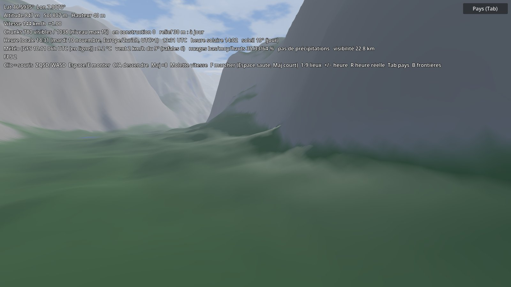 | 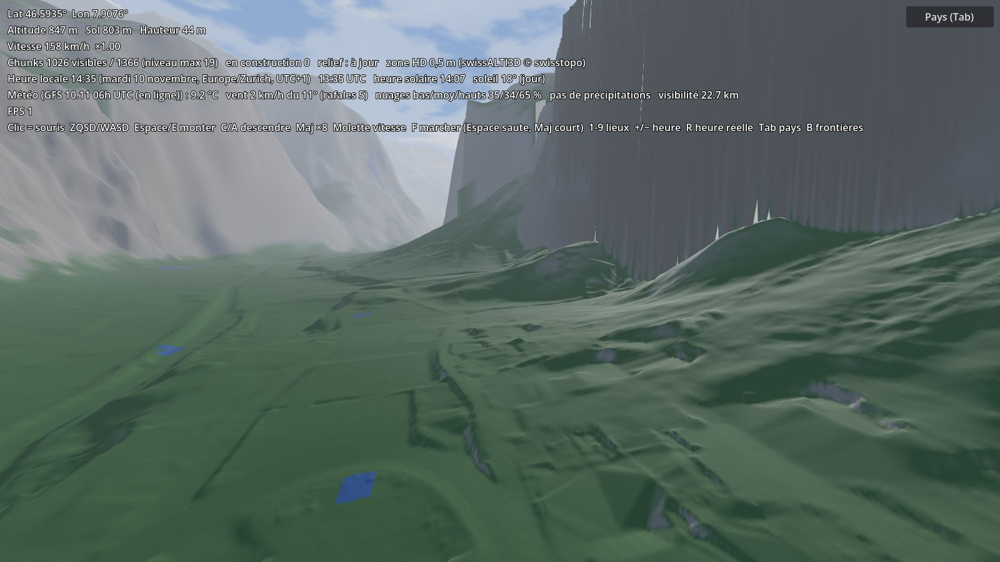 | 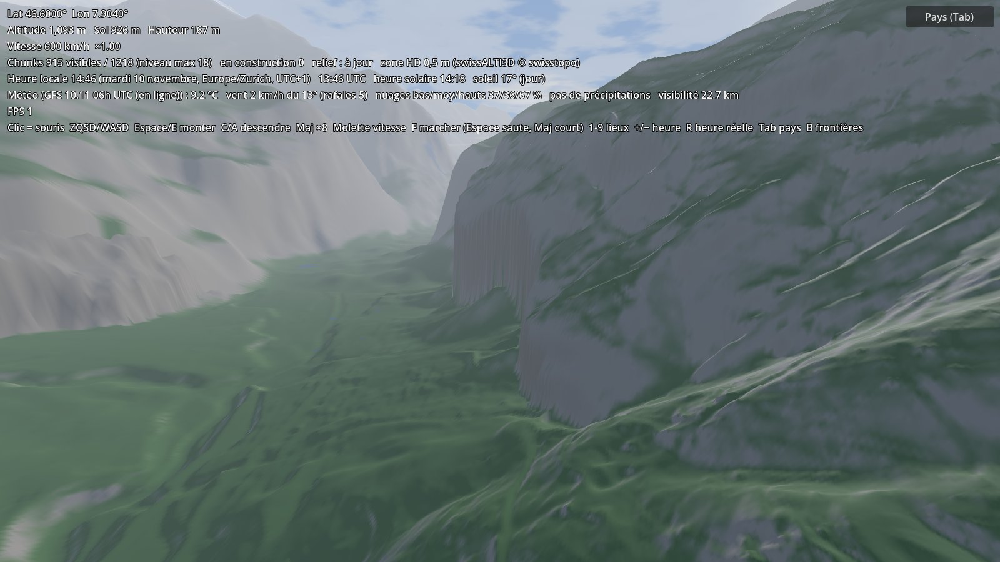 | 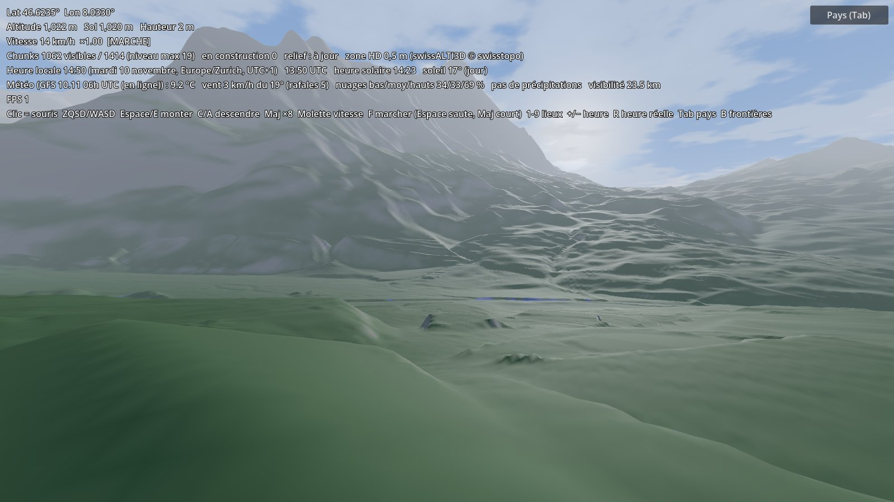 |

## Qualité graphique : Bas, Moyen, Élevé, Ultra

Au premier lancement, le jeu reconnaît la carte graphique et choisit un niveau (touche O pour changer, réglage mémorisé).
Chaque niveau règle la finesse du relief, la densité et la distance des arbres, les ombres, l'anticrénelage, les distances
d'affichage des bâtiments, routes et noms, les nuages et la pluie. **Toute nouvelle amélioration graphique doit passer
par `GraphicsQuality`** : voir [docs/QUALITE_GRAPHIQUE.md](docs/QUALITE_GRAPHIQUE.md).

## Couverture des sols : forêts, champs, glaciers, villes

Le sol est coloré selon **ESA WorldCover 2021** (10 m, monde entier, CC BY 4.0) : forêts, broussailles, prairies,
champs, zones bâties, roche/désert, glaciers et neiges éternelles, zones humides, mangroves, mousses et lichens.

- Près du joueur (`LandCover.cs`) : la classe vient des mêmes fichiers WorldCover que l'eau, déjà téléchargés à la
  demande (aucun téléchargement en plus). Plus on est loin, plus on lit un aperçu grossier (10 m → 640 m).
- Vues lointaines (> 2 km entre sommets) : carte mondiale incluse dans le jeu, `data/landcover/world_cover.bin.gz`
  (0,05° ≈ 5 km, 0,9 Mo), générée par `tools/landcover/build_landcover_base.py` (classe majoritaire par cellule).
- `ChunkBuilder.cs` : une couleur par classe ; feuillus / conifères selon latitude et altitude ; champs en
  parcelles de couleurs différentes (blé, colza, labour, maïs…) ; pentes raides en roche (sauf forêts).
- `Vegetation.cs` : **arbres et buissons en 3D** dans un rayon d'environ 1,5 km (chunks de 10 et 20 m), placés là
  où WorldCover indique forêt, mangrove ou broussailles, plus quelques arbres isolés dans les prés.
  Positions fixes (on retrouve la même forêt), rendu par MultiMesh. Le compteur « arbres » du HUD donne leur nombre.
  - **Essences** : épicéa, sapin, pin, mélèze, feuillus (hêtre, chêne…), bouleau, peuplier, palmier, acacia, buissons,
    choisies selon la latitude, l'altitude et la limite des arbres ; chaque modèle a sa silhouette.
  - **Saisons** : mélèzes dorés puis nus, feuillus roux en automne et dénudés en hiver (hémisphère sud inversé,
    tropiques toujours verts).
  - **Vent réel** : `shaders/tree.gdshader` plie la cime selon l'uniforme global `wind` (vent à 10 m et rafales GFS,
    mis à jour à chaque image par `Vegetation.SetWind`) ; palmiers et peupliers plus souples.
  - **Pas d'arbres dans les rues ni dans les bâtiments** : les contours des bâtiments et un couloir le long de chaque
    route, chemin et voie ferrée (largeur + 1,5 m, sentiers + 0,4 m) retirent les arbres qui tombent dessus
    (`Obstacles.Shape.Clears`).
- `GroundCover.cs` : **herbe, cailloux et rochers** au ras du sol autour du personnage (cases de 16 m, rayon 40 à
  150 m selon la qualité), selon le type de sol ; l'herbe ondule avec le vent réel, les gros rochers sont solides.
- `shaders/terrain.gdshader` : **textures au sol** (herbe, sous-bois, champ, ville/asphalte, terre, roche, neige,
  `data/textures/`, générées par `tools/textures/gen_ground_textures.py`) projetées en triplanaire, mélangées selon
  la classe WorldCover et la pente ; deux échelles mélangées pour casser la répétition (qualité Élevé et Ultra).
  Elles s'effacent au loin au profit des couleurs par sommet.
- **Neige réelle** : la hauteur de neige GFS (SNOD) et le relief du modèle sont ajoutés au fichier météo ; le shader
  la ramène au vrai relief (plus épaisse en altitude, fond au-dessus de 1 à 4 °C), si bien que la limite des neiges
  suit les chutes et les saisons.

| Forêt près d'Interlaken | Forêts et champs près de Berne | Glacier d'Aletsch |
|---|---|---|
| 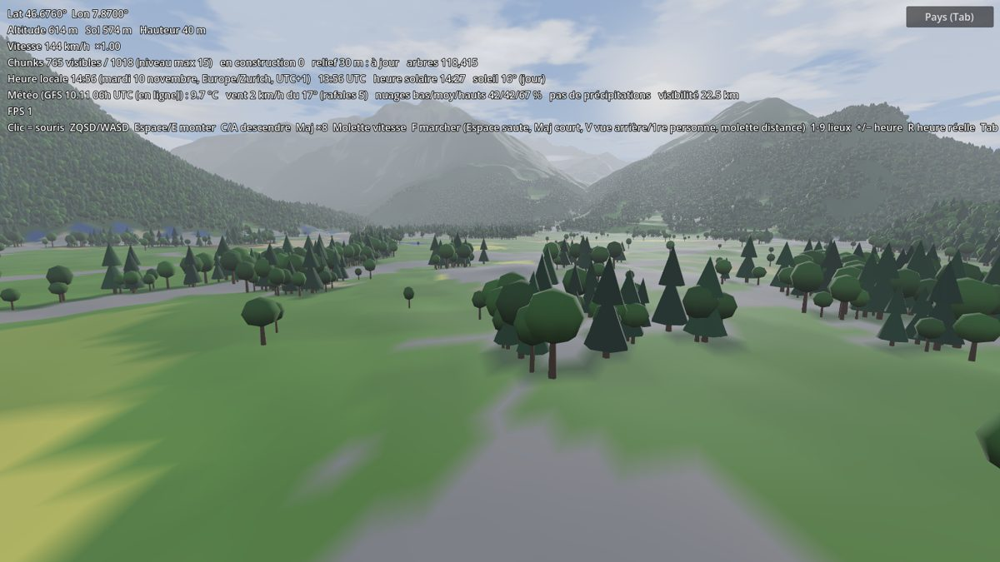 | 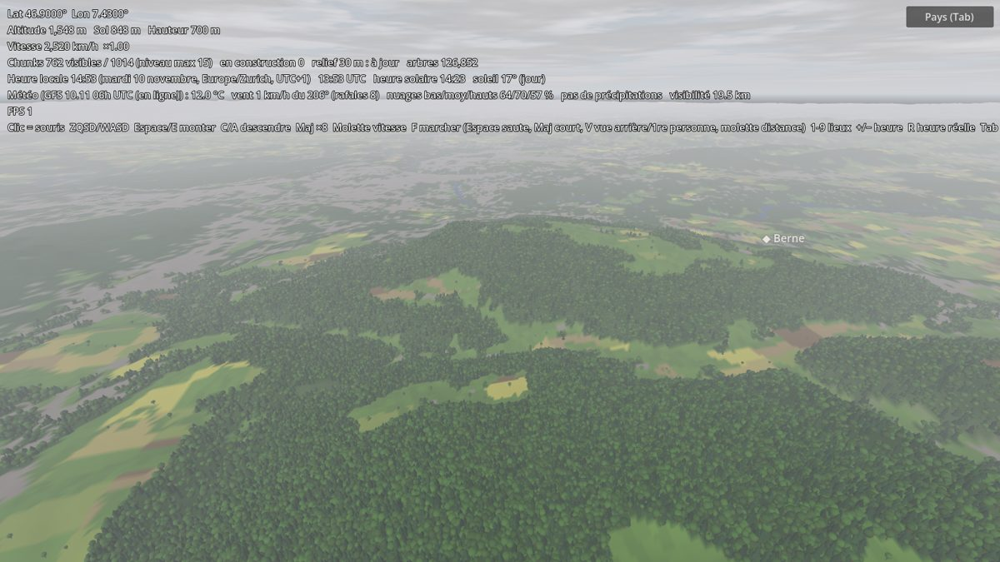 | 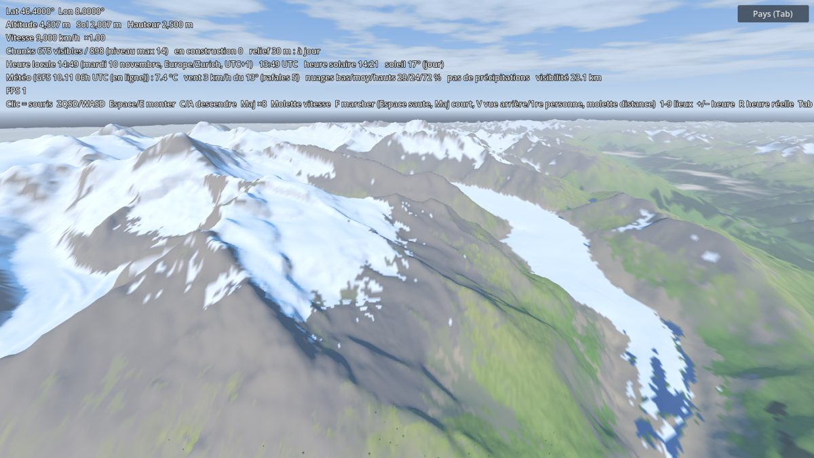 |

Limites actuelles : les routes apparaissent comme zones bâties (grises) dans WorldCover ; la neige GFS est à 1°
(≈ 100 km), corrigée par l'altitude mais sans tenir compte de l'exposition des pentes.

## Collisions avec les décors

`Obstacles.cs` : le personnage (mode marche) ne traverse plus les troncs d'arbres, les buissons ni les murs des
bâtiments ; il glisse le long. Chaque obstacle est une empreinte au sol (cercle, ou contour avec ses **cours
intérieures**, qui restent praticables) avec une altitude de base et un toit. Les obstacles sont rangés dans une grille
d'environ 200 m et rattachés au nœud qui les affiche (chunk d'arbres proche, tuile de bâtiments) : caché = ignoré,
supprimé = retiré. Le déplacement est découpé en pas de 25 cm pour ne rien traverser quand les images sont lentes.

- **Toits** : plats ou à pans (même pente que le maillage), on y marche comme sur le sol et on tombe en passant le bord.
- **Escalade** : tenir **Espace** contre un mur (ou un tronc) fait grimper à 2,5 m/s jusqu'au toit. C'est aussi le
  moyen d'entrer dans une cour fermée : monter, traverser le toit, redescendre.
- **Caméra** : en vue arrière elle se rapproche pour ne pas passer derrière un mur ; en vol libre elle se pose sur les
  toits et ne traverse plus les murs.
- Tests : `-- --at=46.9469,7.444,2,0,-5 --build=46.947,7.444,300 --walktest=200` (Berne, marche vers un mur) ;
  ajouter `--climb` pour escalader (le personnage monte à 12 m, traverse le toit et redescend de l'autre côté).

## Lumières des villes

La nuit, les villes s'allument d'après l'image **NASA Black Marble 2016** (satellite Suomi NPP, capteur VIIRS).
Les images de la NASA ne sont pas soumises au droit d'auteur : usage commercial autorisé, avec mention de la source
et sans laisser croire à un soutien de la NASA. Le shader du terrain (`shaders/terrain.gdshader`) lit la carte par pixel
et ne l'allume que du côté nuit de la planète ; près du sol, la lueur est atténuée et les fenêtres des bâtiments prennent le relais.
La carte est régénérée par le workflow « Lumières des villes » (`tools/nightlights/build_nightlights.py`).

## Océans : vagues, houle réelle et fonds marins

| Atlantique Nord, houle réelle de 3 m | Côte basque | Vue d'avion (reflet du soleil) |
|---|---|---|
| 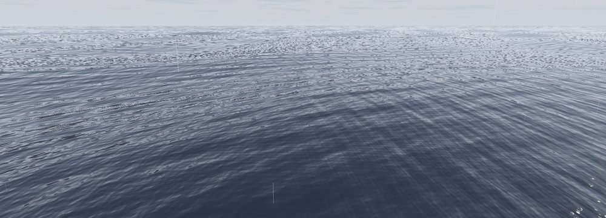 | 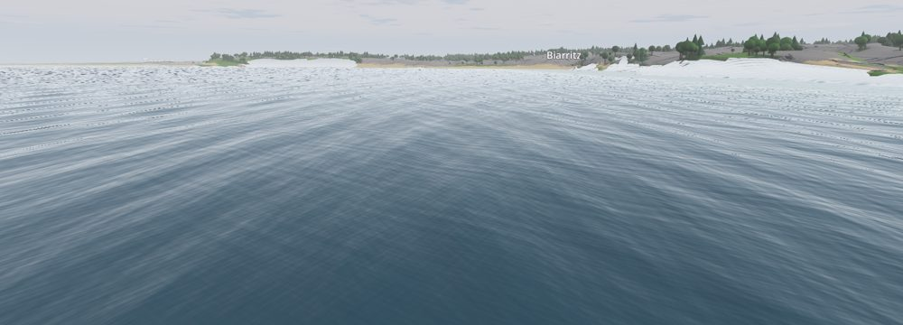 | 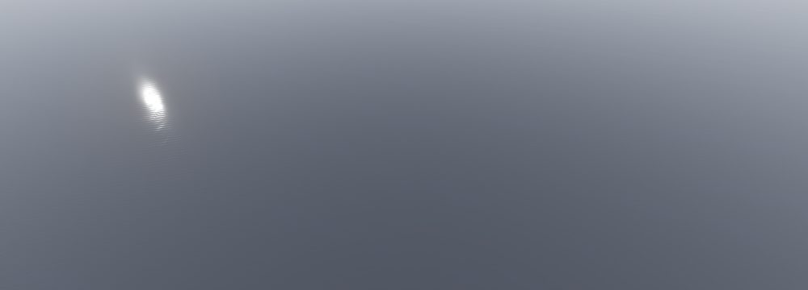 |

- **Fonds marins** (`Bathymetry.cs`) : grille **GEBCO** (15″ ≈ 450 m, domaine public, usage commercial autorisé,
  mention « GEBCO Compilation Group, GEBCO Grid »). Le workflow `.github/workflows/gebco.yml` télécharge la grille
  (le site GEBCO n'est pas joignable partout, il l'est depuis GitHub Actions), la découpe en 64 COG de 30° × 30°
  (`tools/bathymetry/`) et les publie dans la release `gebco`. Le jeu n'en lit que les morceaux utiles, comme le
  relief Copernicus, avec la carte mondiale de base en attendant. À relancer seulement pour une nouvelle grille annuelle
  (modifier `tools/bathymetry/VERSION` ou *Actions → Fonds marins GEBCO → Run workflow*).
- **Surface de l'eau** (`ChunkBuilder.cs`, `Ocean.cs`, `shaders/ocean.gdshader`) : chaque chunk qui touche de l'eau
  reçoit une surface au niveau de la mer (ou du lac), qui déborde un peu sous la plage : le rivage est l'intersection
  avec le relief. Le relief, lui, descend jusqu'au fond GEBCO. Lacs et rivières gardent leur niveau mesuré (fond
  supposé à 3 m, inconnu).
- **Vagues** : somme de 16 à 64 vagues (selon la qualité) de Gerstner (déplacement des sommets + normales par pixel), construites à partir de
  l'état de la mer réel au-dessus du joueur : **mer du vent + deux houles** (hauteur, période, direction) de
  **NOAA GFS-Wave / WAVEWATCH III** (domaine public), plus le clapot et les rides poussés par le vent GFS local.
  Les vecteurs d'onde sont sur une grille de pas 2π/8 192 m dans le repère de la planète : la phase est continue d'un
  chunk à l'autre et précise en float partout sur la Terre. Les vagues s'amortissent sur les plages ; écume sur les
  crêtes raides (selon le vent) et rouleaux près du rivage ; couleur selon la profondeur (sable, turquoise, bleu nuit).
  En mer, le quadtree descend au niveau 17 (≈ 2,5 m) près de la surface pour que les vagues aient assez de sommets.
- **Houle réelle** (`Waves.cs`) : `tools/ocean/build_waves.py` extrait de GFS-Wave 0,25° (AWS Open Data) la hauteur
  totale, la mer du vent et les deux premières houles pour 28 h, à 0,5° (~7 Mo). Le workflow *Météo GFS* le publie
  toutes les 6 h dans la release `weather-latest` (`waves.bin.gz`) ; fichier de secours `data/ocean/waves_fallback.bin.gz`.
  Près des côtes, on prend le point de mer le plus proche. Le HUD affiche l'état de la mer (ligne « Océan »).
- **Plonger** : en vol libre, au-dessus de la mer, C (ou A) descend sous la surface jusqu'au fond (brouillard bleu-vert,
  lumière qui baisse avec la profondeur). En mode marche, l'eau reste une surface (la nage viendra plus tard).
- **Bateaux** : `Ocean.HeightAt(position, t)` donne la hauteur des vagues affichées (même formule que le shader) ;
  elle est branchée automatiquement sur `WaterSurface.Waves` quand les véhicules sont présents.
- **Qualité** (`GraphicsQuality`) : Bas / Moyen / Élevé / Ultra → 16 / 32 / 48 / 64 vagues, maillage en mer de 5 m à 1,2 m
  (`WaterWaves`, `WaterMaxLevel`, voir docs/QUALITE_GRAPHIQUE.md). Pas de réflexions en espace écran : le ciel est reflété
  par la carte d'environnement, donc ça marche aussi en mode Compatibilité.

## Véhicules : route, deux-roues, eau, air

| Route (citadine, sport, 4×4, pick-up Kenney, camionnette, tracteur) | Vélo, moto, bus, camion | Voilier sur le lac de Thoune |
|---|---|---|
| 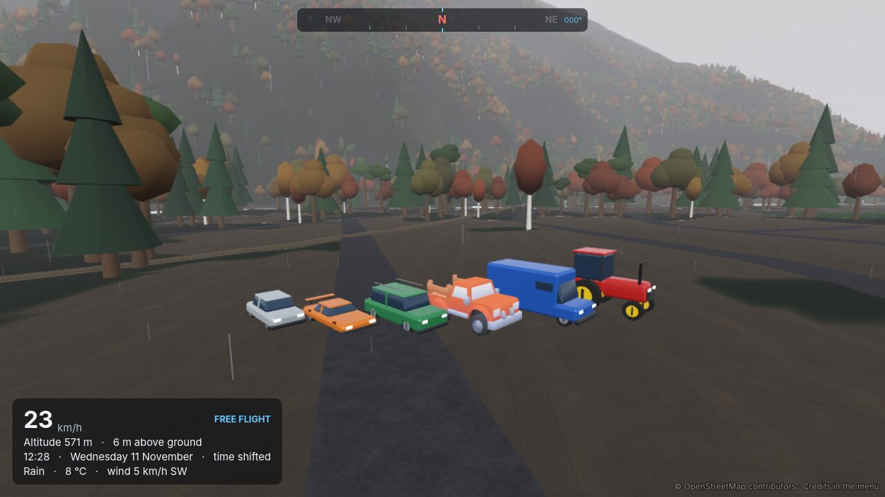 | 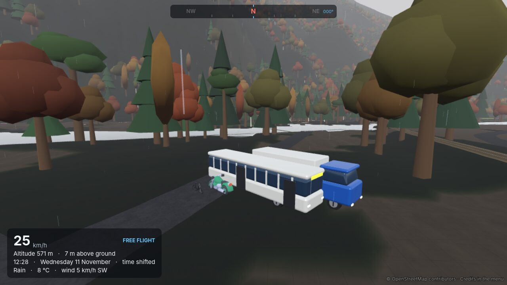 | 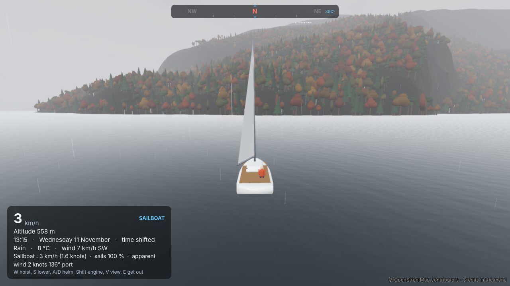 |

| Vue intérieure : voiture de sport | Vue intérieure : avion de tourisme (badin, horizon, altimètre, vario, cap, gaz) |
|---|---|
| 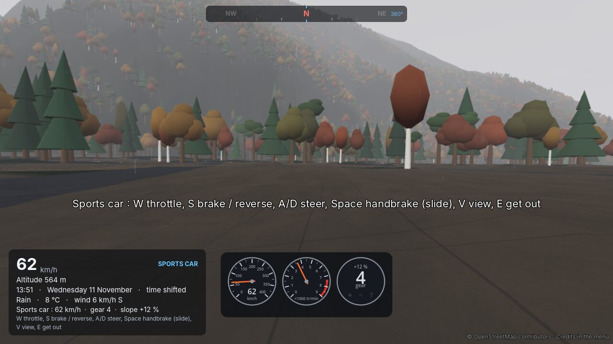 | 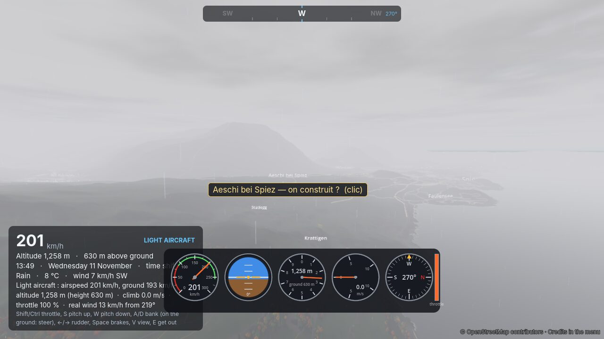 |

Touche **G** : un menu en 4 colonnes (flèches + Entrée, clavier uniquement), le véhicule apparaît devant le personnage
et on monte dedans. **E** pour descendre (à l'arrêt) ou remonter dans un véhicule garé à côté. **V** passe en vue
intérieure avec un **tableau de bord** dessiné (compteurs ronds). Jusqu'à 10 véhicules restent garés ; on ne traverse
pas un véhicule garé. La molette rapproche ou éloigne la caméra.

| Catégorie | Véhicules (`VehicleCatalog` dans `VehicleSpec.cs`) |
|---|---|
| Route | citadine, voiture de sport, 4×4, pick-up (modèle Kenney), camionnette, bus, camion, tracteur |
| Deux-roues | vélo, moto (modèle Kenney) |
| Sur l'eau | bateau à moteur, jet-ski, voilier |
| Dans les airs | avion de tourisme, avion de ligne, hélicoptère |

Chaque véhicule est une fiche (`VehicleSpec`) : vitesse maxi, accélération, freinage, adhérence, dimensions, place du
conducteur, son. Les modèles stylisés sont construits en code (`ToyMesh.cs` : boîtes arrondies, volumes profilés ;
`VehicleModels.cs`), dans l'esprit des modèles Kenney (pick-up et moto viennent du Starter Kit Racing, CC0).

**Physique arcade, facile au clavier** (une classe par famille) :

| Famille | Commandes | Physique |
|---|---|---|
| Route (`RoadVehicle.cs`) | Z/↑ accélérer, S/↓ freiner puis reculer, Q/D ou ←/→ tourner, Espace frein à main | Accélération qui diminue vers la vitesse maxi, pente ressentie en partie, direction moins sensible à haute vitesse. L'adhérence limite le virage : au-delà l'arrière glisse un peu (contre-braquage automatique) ; le frein à main fait **déraper** dans les virages. Boîte automatique (rapport et régime pour le son et le compte-tours). |
| Deux-roues | idem ; vélo : Maj en danseuse | Penchent dans les virages (atan(v·lacet/g)), ne dérapent pas. Le vélo sent le vent réel. |
| Bateaux (`Boat.cs`) | Z avant, S arrière, Q/D gouvernail | La vitesse tend vers gaz × vitesse maxi ; gouvernail efficace seulement avec de l'eau qui le traverse ; flottaison sur les vagues réelles, cabrage en déjaugeant, gîte, échouage sur la rive. |
| Voilier | Z hisser, S affaler, Q/D barre, Maj moteur | Poussée par le **vent réel GFS** selon l'allure : rien face au vent (< 35°), le mieux du travers au grand largue ; la bôme passe sous le vent, le bateau gîte. |
| Avions (`Plane.cs`) | Maj/Ctrl gaz, S cabrer, Z piquer, Q/D incliner, ←/→ palonnier, Espace freins | Taux de tangage et de roulis au clavier, retour à plat quand on lâche, virage coordonné ; on accélère en piqué, on ralentit en montée ; sous la vitesse de décrochage le nez tombe (alarme). Vent réel : l'avion dérive. Décollage en tirant S au-delà de la vitesse de rotation. Crash si on touche trop fort, trop incliné, sur l'eau ou contre un bâtiment. |
| Hélicoptère (`Helicopter.cs`) | Maj monter, Ctrl descendre, Z/S avancer/reculer, Q/D tourner, ←/→ glisser | Vitesse qui tend vers la consigne (stabilisé), rotor à lancer avant de décoller, inclinaison visuelle, dérive au vent. |

**Sons** (`VehicleAudio.cs`) : moteur Kenney (CC0) en boucle dont la hauteur suit le régime, crissement des pneus selon
le dérapage, chocs ; synthétisés en direct : vent selon la vitesse, eau, hélice, réacteur, pales du rotor, roue libre
du vélo, alarme de décrochage. Licences dans `assets/vehicles/LICENCES.md`.

Tests : `--vehicle=<id>` (car, sport, suv, pickup, van, bus, truck, tractor, bike, moto, boat, jetski, sailboat, plane,
airliner, heli), `--firstperson` (vue intérieure), `--showroom=car,bus,…` (véhicules garés en rang devant la caméra).

La surface de l'eau vient de `Vehicles/WaterSurface.cs` : niveau des lacs et de la mer d'après le relief, plus
`WaterSurface.Waves` (en mer seulement) : `Ocean.HeightAt`, la même houle que celle affichée, s'y branche tout seul ;
le bateau monte et descend exactement avec les vagues réelles (NOAA GFS-Wave).

## Météo et heure réelles

Le jeu est synchronisé avec la réalité : **heure UTC réelle** (position du Soleil calculée, jour/nuit) et
**météo réelle** issue du modèle **NOAA GFS** (domaine public, usage commercial autorisé).

- `tools/weather/build_weather.py` télécharge sur AWS Open Data la dernière prévision GFS 1°
  (vent à 10 m et ~1 500 m, rafales, température, nuages bas/moyens/hauts, pluie, part de neige, visibilité)
  pour les 27 prochaines heures, et l'écrit dans un fichier compact (~3 Mo).
- Le workflow GitHub Actions `.github/workflows/weather.yml` le régénère **toutes les 6 h** et le publie dans la
  release `weather-latest` : c'est le « serveur météo », gratuit.
- Le jeu (`Weather.cs`) télécharge ce fichier au démarrage puis toutes les 30 min, le garde en cache, et interpole
  dans l'espace et le temps. Sans connexion, il utilise le cache ou `data/weather/fallback.bin.gz`.
- `Atmosphere.cs` en fait : soleil et ciel jour/nuit/couvert, brouillard selon la visibilité, trois couches de nuages
  poussées par le vent réel, couverture nuageuse mondiale vue de l'espace, pluie et neige.
- Pour les véhicules : `WeatherSample.WindAt(hauteur)` donne le vent (est, nord) en m/s.

### Fuseaux horaires

Le jour et la nuit dépendent de la vraie position du Soleil, donc de l'heure UTC et du lieu. L'**heure légale locale**
(fuseau, heure d'été) est donnée par `TimeZones.cs` :

- `data/timezones/timezones.bin.gz` (~750 Ko) : carte mondiale des 444 fuseaux IANA à 0,025° (~2,8 km), océans compris,
  générée par `tools/timezones/build_timezones.py` à partir de
  [timezone-boundary-builder](https://github.com/evansiroky/timezone-boundary-builder) (version 2026b).
- Les règles (décalage, dates d'heure d'été) viennent de la base IANA du système via .NET `TimeZoneInfo`,
  donc restent à jour avec Windows/macOS/Linux.
- `TimeZones.LocalTime(utc, lat, lon, …)` est utilisable partout dans le jeu (horaires, PNJ, éclairage public…).

Pour mettre à jour la carte quand une nouvelle version sort :
`python build_timezones.py combined-with-oceans.json ../../data/timezones/timezones.bin.gz 0.025`.

| Ciel réel sur Interlaken | Nuages GFS sur l'Europe | Terminateur jour/nuit |
|---|---|---|
| 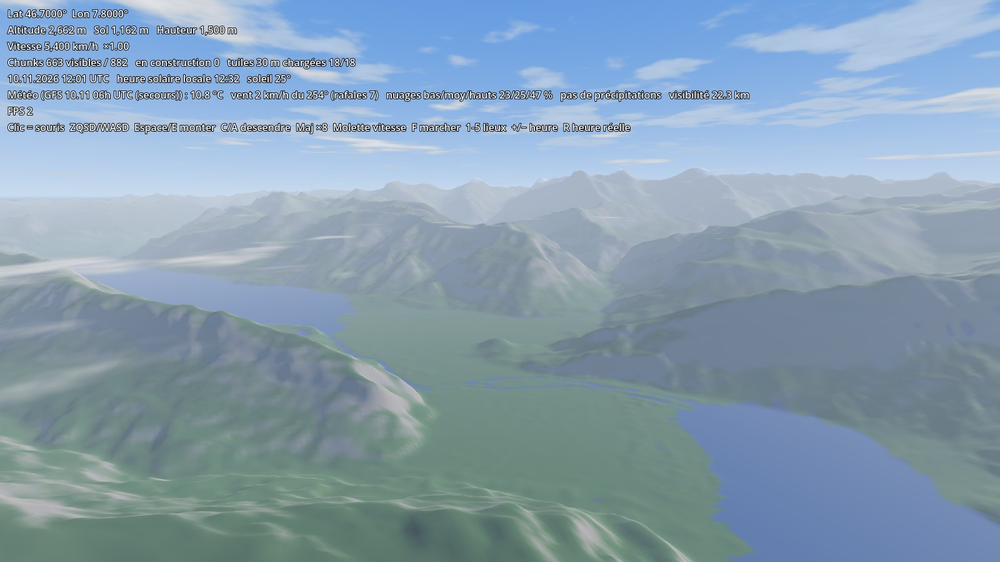 | 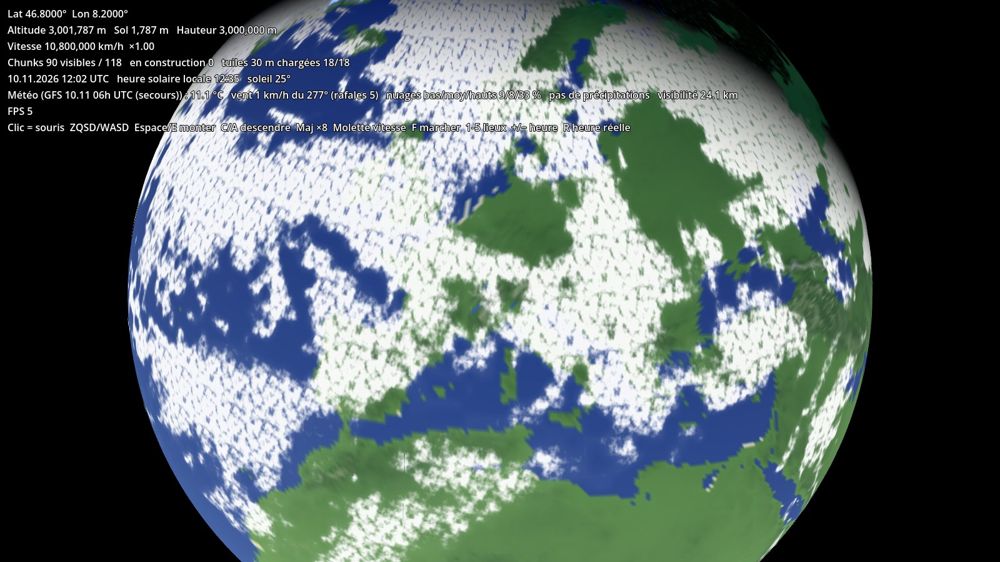 | 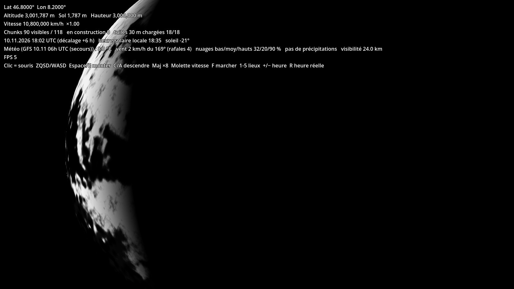 |

Après la fusion dans `main`, lancer une première fois le workflow à la main :
*Actions → Météo GFS → Run workflow*.

## Frontières et capitales

- `tools/geo/build_geo.py` extrait de **Natural Earth** (domaine public) les frontières terrestres et les capitales de
  203 pays et territoires (noms en français) → `data/geo/borders.bin.gz` et `data/geo/countries.json`.
- `PoliticalLayer.cs` : frontières en lignes fines posées sur le relief, capitales en étiquettes visibles à moins de ~800 km.
- `CountryMenu.cs` : liste alphabétique « Pays (Capitale) » avec recherche ; un clic place le joueur 500 m au-dessus de
  la capitale, 1,5 km au sud, en la regardant.
- Les frontières suivent la représentation *de facto* de Natural Earth ; quelques choix de capitales sont fixés dans le
  script (Pretoria, Astana, Dodoma, Porto-Novo…).

| Menu des pays | Arrivée au-dessus de Berne | Frontière franco-suisse sur le Léman |
|---|---|---|
| 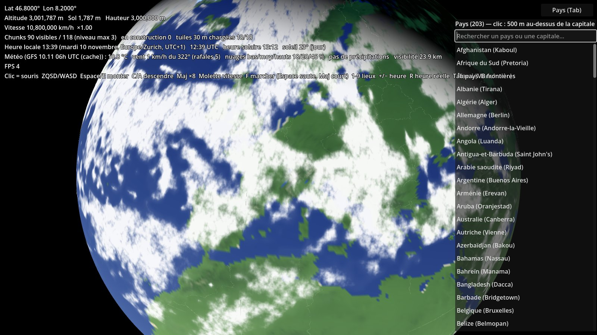 | 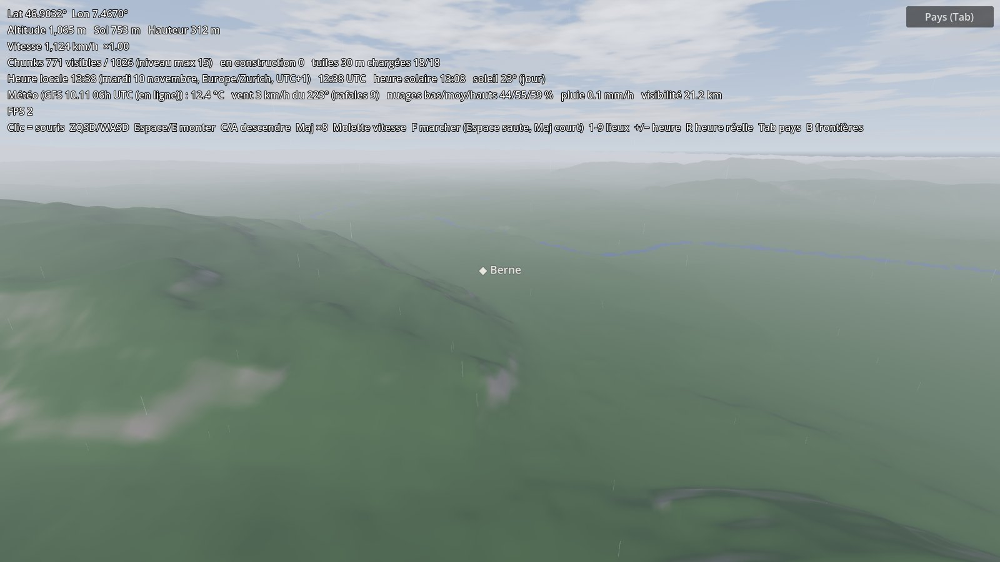 | 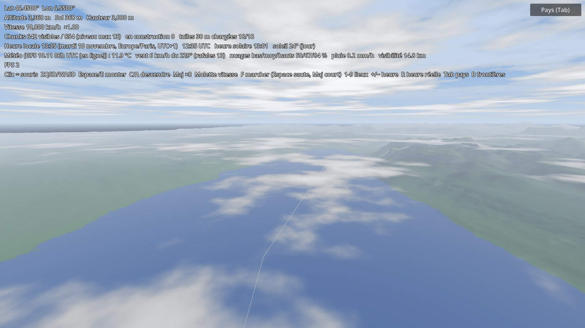 |

## Routes, chemins, voies ferrées, villes et villages

Toutes les routes, tous les chemins et toutes les voies ferrées du monde, ainsi que les noms de toutes les villes,
villages et hameaux, viennent d'**OpenStreetMap**, via les tuiles vectorielles mondiales publiées chaque mois par
**Overture Maps** sur AWS Open Data (archives PMTiles : `transportation` 134 Go, `divisions` 20 Go). Comme pour le relief,
rien n'est dans le dépôt : le jeu ne télécharge (requêtes HTTP partielles) que les tuiles autour du joueur et les garde
dans `user://cache/overture/`.

- `Data/PmTiles.cs` : lecteur PMTiles v3 (répertoires, courbe de Hilbert, cache disque) ; `Data/Mvt.cs` : décodeur de
  tuiles vectorielles (protobuf) ; `Data/Overture.cs` : trouve la version la plus récente (les anciennes sont supprimées
  du serveur) et garde la liste en cache pour jouer hors ligne.
- `RoadLayer.cs` + `RoadBuilder.cs` : jusqu'à ~3 km (5 km en altitude), tuiles de zoom 14 avec **tous les tronçons** en
  rubans de leur vraie largeur (largeur OSM si connue), posés sur le relief 30 m : autoroutes, routes, rues, chemins
  agricoles, sentiers, escaliers, voies ferrées (ballast + deux rails), trams, funiculaires. Revêtements dessinés par un shader, sans texture à charger : asphalte avec lignes blanches (bords et ligne médiane
  en tirets) sur les grandes routes, pavés, chemins de gravier avec bande d'herbe, sentiers en terre ; voies ferrées
  en ballast clair avec traverses tous les 0,6 m et rails en acier brillant, trams noyés dans la chaussée.
  Les **ponts** sont tendus
  entre leurs culées et dessinés comme des ouvrages en béton (tablier épais, parapets, piles jusqu'au sol tous les
  ~25 m). Aux carrefours, les lignes blanches s'estompent ; en ville, pas d'accotements ni de murets ; les bretelles
  n'ont pas de ligne médiane. Les **tunnels** et voies souterraines ne sont pas dessinés. Au-delà, jusqu'à ~20–60 km : tuiles
  de zoom 12 en lignes fines, masquées là où le détail est chargé.
- `PlacesLayer.cs` : noms des localités (villes, villes moyennes, villages, hameaux), en français quand OSM le connaît
  (Genève, Lucerne, Munich…). Plus le lieu est petit, plus il faut s'approcher : hameaux à 4 km, villages à 12 km,
  villes moyennes à 35 km, grandes villes jusqu'à 1 000 km. Les capitales gardent leur étiquette ◆.
- La mention **« © contributeurs OpenStreetMap (ODbL), Overture Maps Foundation »** est affichée en bas à droite de
  l'écran : elle est obligatoire (licence ODbL) et devra aussi figurer dans les crédits du jeu.

| Interlaken depuis 350 m | Sentiers du Harder | À pied sur un chemin |
|---|---|---|
| 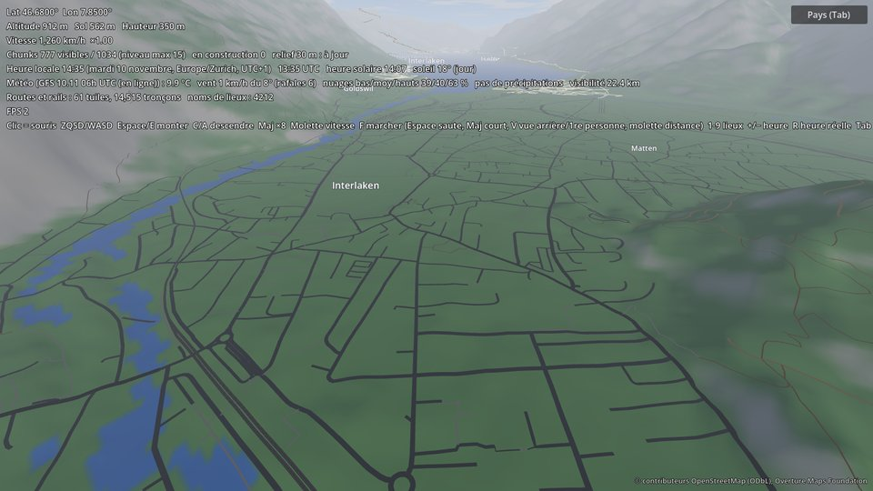 | 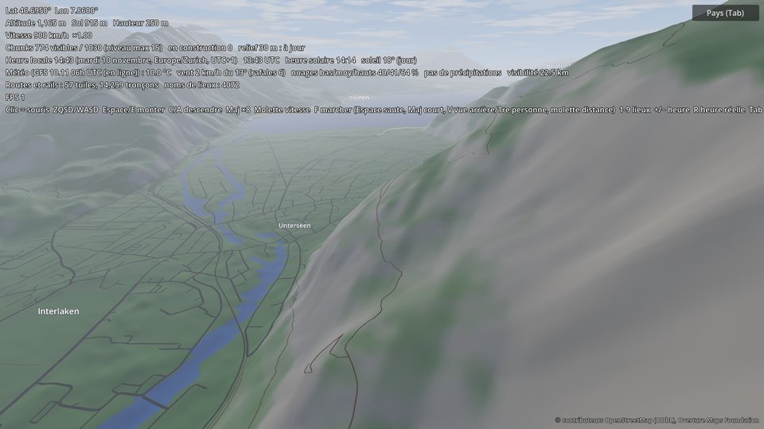 | 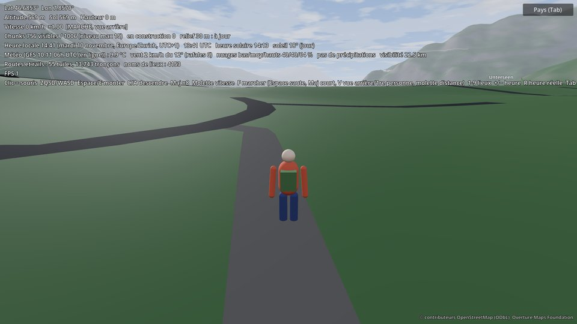 |

Pour la version commerciale, il sera plus sûr de copier les deux archives sur un serveur à nous (ou un CDN) plutôt que
de dépendre du bucket d'Overture : il suffit de changer `Overture.Bucket`.

## Transports : gares, arrêts, ports, aéroports, noms de rues

- `TransitLayer.cs` (touche P) : gares et haltes, stations de métro, arrêts de tram et de bus, gares routières,
  débarcadères et ports, funiculaires, téléphériques. Source : OpenStreetMap via Overture Maps, archive `base`
  (couche `infrastructure`, uniquement au zoom 13, ~3 km par tuile), chargée dans un rayon de ~3 km quand on est à moins
  de 2,5 km du sol. Le mode (train, métro, tram, bus…) est déduit de la classe Overture et des étiquettes OSM d'origine
  (`source_tags`). Les quais et poteaux d'un même arrêt (« Bern Bahnhof (Z) », « (H) »…) sont regroupés en un seul
  pictogramme. Les gares se voient à ~4,5 km, les arrêts de bus à ~550 m.
- Aéroports : `data/transport/airports.tsv.gz` (49 000 aéroports, aérodromes et hydrobases d'**OurAirports**, domaine
  public, `tools/transport/build_airports.py`), avec leur code IATA : grands aéroports visibles jusqu'à 350 km (d'avion),
  aéroports régionaux à 120 km, aérodromes à 15 km.
- `StreetNamesLayer.cs` (touche N) : noms des rues et routes (mêmes tuiles z14 que les routes, déjà en cache), au-dessus
  de la chaussée quand on s'en approche (~250 m pour une rue, 600 m pour une route principale).
- `LabelTileLayer.cs` : base commune (chargement par tuiles, fusion des doublons, fondu, altitude affinée en s'approchant).
- Pictogrammes : `data/transport/icons.rgba.gz`, dessinés depuis la police Noto Color Emoji (SIL OFL 1.1, voir
  `data/transport/LICENCES.md`) par `tools/transport/build_icons.py`.

| Berne : gare, arrêts de bus et de tram | Genève : débarcadères, gare routière, rues | Aéroport de Zurich d'avion |
|---|---|---|
| 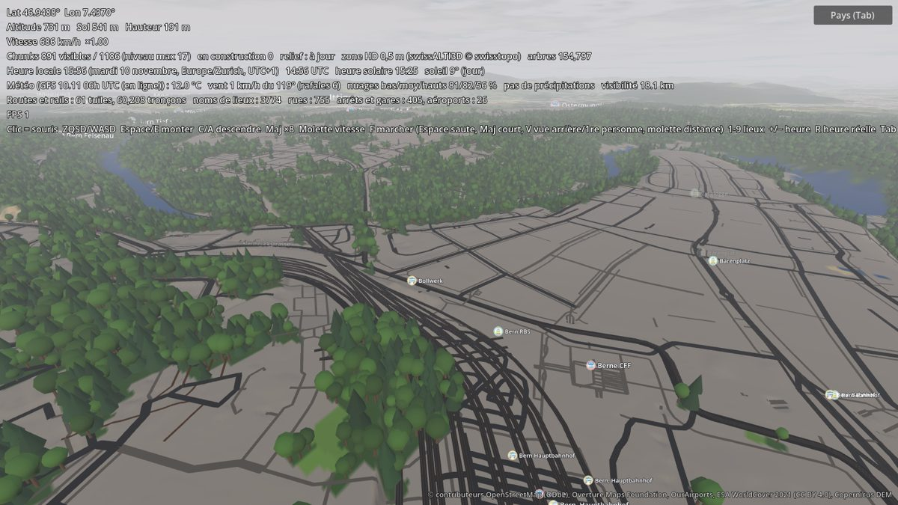 | 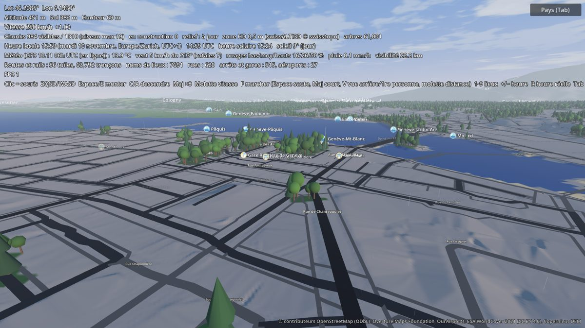 | 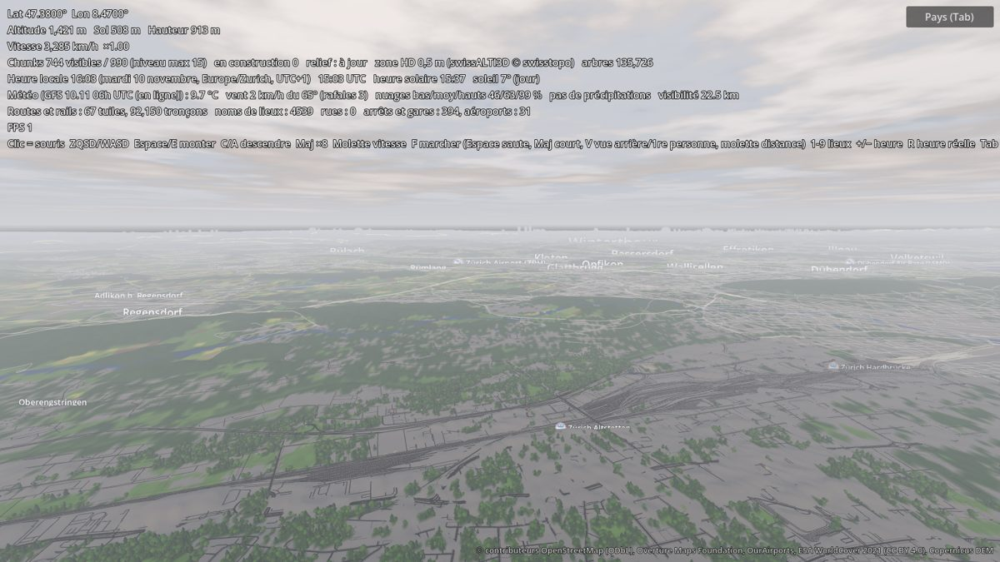 |

### Voyager en transports publics suisses, aux horaires réels

Tous les trains, trams, bus, cars postaux, bateaux, funiculaires et téléphériques de Suisse, avec leur horaire
officiel (**opentransportdata.swiss**, GTFS, usage commercial autorisé avec mention de la source) :

1. Près d'un arrêt (≤ 250 m), **H** affiche les prochains départs de tout le pôle (la gare et les arrêts de bus et
   de tram autour), à l'heure suisse du jeu : l'heure réelle, ou décalée avec + / −.
2. **1–9** pour choisir. On attend sur place : le véhicule arrive quelques minutes avant, et l'on monte
   automatiquement à l'heure du départ si l'on est à moins de 300 m. **H** pendant l'attente : renoncer.
3. Le voyage dure le **temps réel** de l'horaire (Berne → Fribourg : 33 min). La caméra suit le véhicule
   (molette = distance, V = vue du passager) ; le panneau montre les prochains arrêts. **H** : descendre au prochain
   arrêt (on descend aussi au terminus), on repart à pied. + / − avancent l'heure : le voyage avance d'autant.

- `tools/transport/build_timetable.py` réduit le GTFS suisse (2,4 Go, 1,9 million de courses par an) à un fichier de
  12 Mo : les courses qui desservent les mêmes arrêts avec les mêmes temps de parcours partagent un « motif ».
- Workflow GitHub Actions « Horaires transports suisses » : chaque jeudi, nouvelle version dans la release
  `timetable-latest` ; le jeu la télécharge (au plus une fois par jour) et la garde en cache (`user://cache/`).
- `Data/Timetable.cs` : lecture et recherche des départs ; `TransitRide.cs` : tableau, attente, voyage, descente.

Limites de cette première version : le véhicule va **en ligne droite** d'un arrêt à l'autre en suivant le relief
(pas encore sur les vrais rails, ni dans les tunnels) et c'est une simple boîte ; pas encore de retards en temps
réel ni d'autres véhicules qui circulent. Prochaine étape : tracés réels des lignes (pfaedle + OpenStreetMap dans
le workflow), puis retards en direct (GTFS-RT d'opentransportdata.swiss, clé gratuite).

| Tableau des départs, gare de Berne | Dans le S1 vers Fribourg |
|---|---|
| 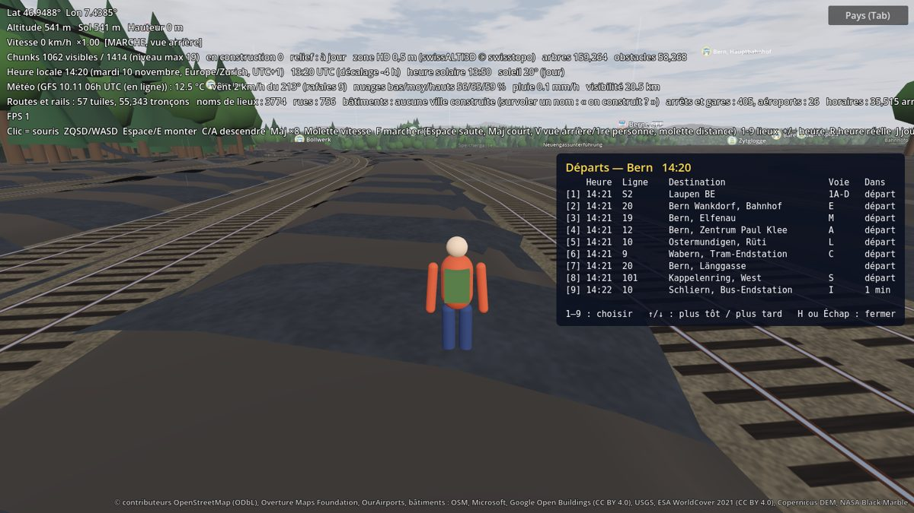 | 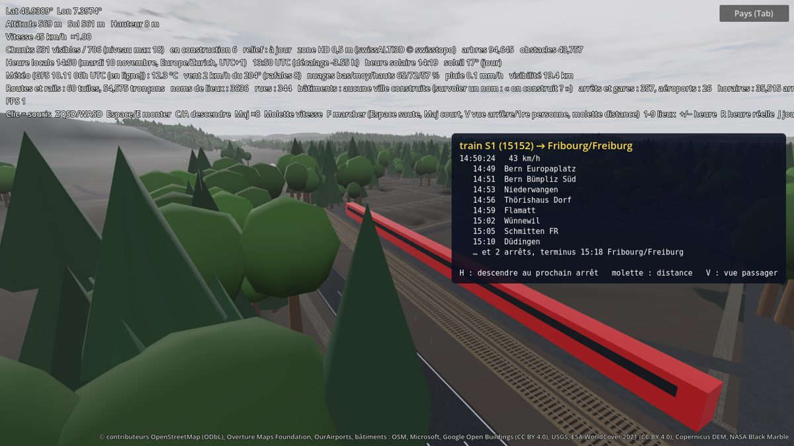 |
## Menu de départ : commencer n'importe où

Au lancement (et ensuite avec **M**), le joueur choisit où commencer :

- **Reprendre** là où il était (position gardée toutes les 5 s dans `user://last_position.json`) ;
- **chercher n'importe quelle ville ou village de la Terre** (1 691 512 localités OpenStreetMap via Overture :
  villes, villes moyennes, villages ; nom français, sinon anglais, sinon local, et le nom local en plus quand il diffère,
  ex. « Berne » trouvée aussi en tapant « Bern », « Toyonaka » « 豊中市 ») ou un pays : on arrive 500 m au-dessus et
  la localité est construite. Résultats : nom exact, puis début du nom, puis le reste, les plus grandes villes d'abord ;
  région et population affichées pour distinguer les homonymes. Fichier `data/geo/localities.tsv.br` (19 Mo, Brotli),
  généré par `tools/geo/build_localities.py` depuis le GeoParquet Overture « divisions », chargé en ~1,5 s en
  arrière-plan (~135 Mo en mémoire), recherche en ~10 ms (`Data/Localities.cs`) ;
- **cliquer sur la Terre** : chaque clic rapproche (de l'orbite jusqu'à ~25 km), le dernier clic atterrit à cet endroit
  exact, n'importe où sur la planète. Clic droit ou « Reculer » : vue plus large.

Les tests automatiques (`--at`, `--view`, `--country`, `--build`…) sautent ce menu ; `--start` le force.

## Bâtiments des villes et villages, à la demande

Les bâtiments réels ne sont construits que là où le joueur le demande :

- en survolant le nom d'une ville ou d'un village (souris libre après Échap, ou viseur au centre de l'écran en vol),
  l'invite **« Berne — on construit ? »** apparaît : **clic** (ou **K** en vol) pour construire, **Maj + clic / Maj + K**
  pour démolir. Pendant la construction, l'invite montre l'avancement (tuiles, nombre de bâtiments) ;
- choisir un pays dans le menu **Tab** construit aussi sa capitale.

La zone construite est un disque autour du centre : ~350 m pour un hameau, 700 m pour un village, 1,5 km pour une
petite ville, 4 km pour une capitale, 2 à 7 km pour une ville selon sa population, 8 km pour une mégapole.
Les **grandes villes s'agrandissent au fur et à mesure** : quand le joueur arrive à moins de 1,5 km du bord de la zone
déjà construite, elle grandit (jusqu'à 15 km pour une capitale, 6 à 20 km pour une ville, 30 km pour une mégapole) ;
seules les tuiles du nouvel anneau sont reconstruites.
Les villes construites sont gardées dans `user://cities.json` et réapparaissent au lancement suivant (leurs tuiles ne
sont chargées que lorsqu'on est à moins de ~60 km ; visibles jusqu'à ~40 km).

- Source : **Overture Maps « buildings »** (`buildings.pmtiles`, même bucket AWS que les routes, 180 Go dont on ne lit
  que les tuiles de zoom 14 utiles, ~0,2 à 1,4 Mo chacune). Contours OpenStreetMap complétés par Microsoft ML Buildings
  (ODbL), Google Open Buildings (CC BY 4.0) et USGS Lidar (domaine public) : usage commercial autorisé avec mention.
- `BuildingBuilder.cs` : murs extrudés depuis le contour (cours intérieures comprises), posés sur le relief (le plus bas
  point du contour, fondations de 6 m sous le sol pour ne jamais flotter). Hauteur = `height` d'OSM, sinon nombre
  d'étages × 3 m, sinon une valeur selon le type (maison, immeuble, église, industrie…) et la surface.
  Toits : à deux pans, à quatre pans, en pavillon ou en appentis quand OSM le dit (ou par défaut pour les petites
  maisons à peu près rectangulaires), sinon plats. Les « building parts » d'OSM (églises, tours…) remplacent le contour.
  Couleurs de façade et de toit d'OSM quand elles existent, sinon selon le matériau ou le type.
- `BuildingsLayer.cs` : invite (seulement à plus de 500 m au-dessus du sol, pour ne pas encombrer la vue en ville),
  liste des villes, tuiles, et un shader qui dessine les fenêtres (étages de 3 m) et les allume la nuit selon l'heure
  locale : ~50 % en soirée, ~6 % entre 1 h et 5 h, un regain vers 6–7 h ; ce sont toujours les mêmes fenêtres qui
  s'éteignent.

Exemple : Berne (rayon 4 km) = 20 825 bâtiments, ~30 tuiles.

| Berne, la vieille ville et la cathédrale | Lauterbrunnen | Berne agrandie, à la tombée de la nuit | Menu de départ |
|---|---|---|---|
| 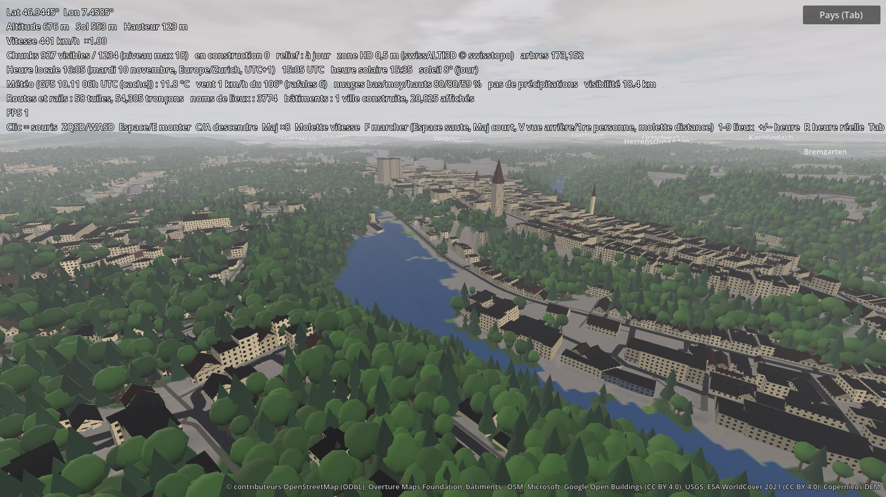 | 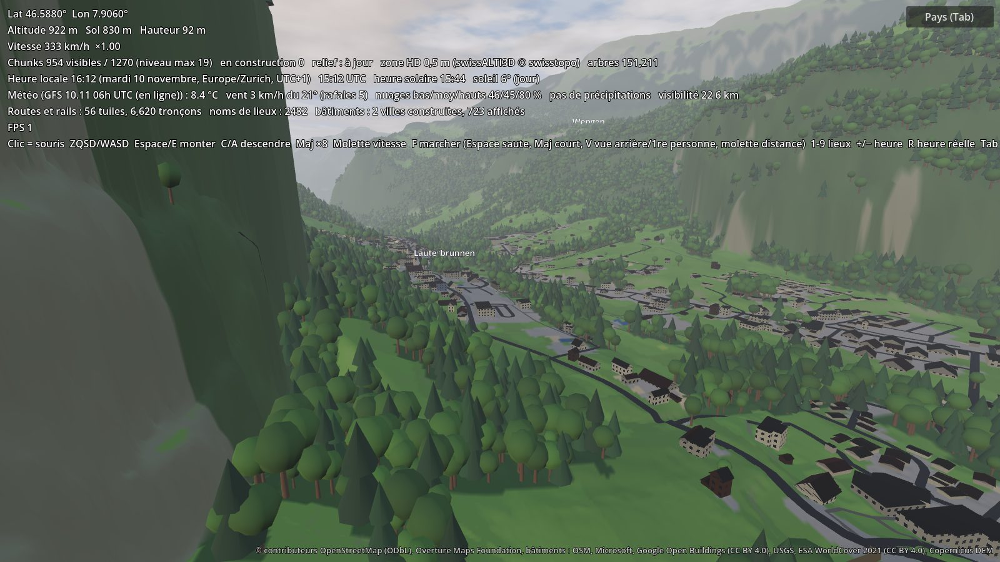 | 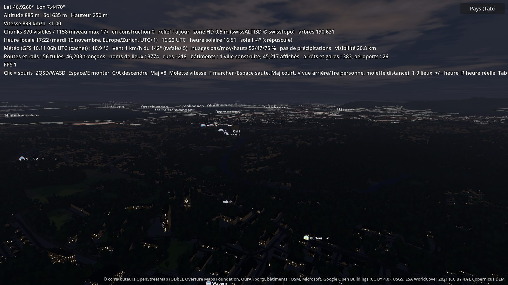 | 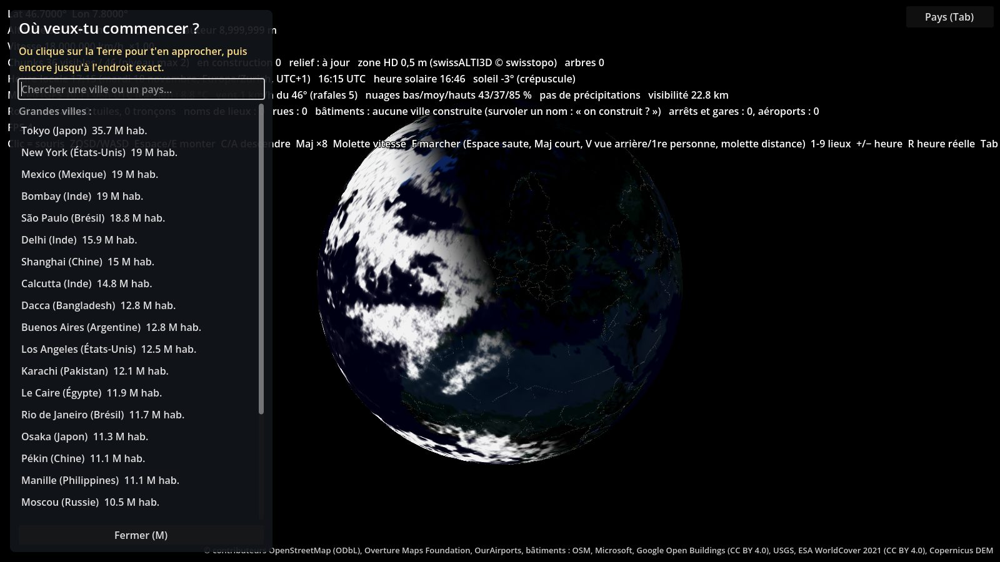 |

### Suisse : les vrais bâtiments (swissBUILDINGS3D)

En Suisse et au Liechtenstein, les bâtiments proches du joueur viennent de **swissBUILDINGS3D 3.0** (swisstopo,
licence OGD, usage commercial autorisé avec « © swisstopo ») : vrais toits (pans, croupes, débords, lucarnes),
chalets, églises et clochers tels qu'ils sont, au lieu de boîtes extrudées.

- **Conversion** (`tools/swissbuildings3d/build_tiles.py`, workflow *Bâtiments suisses*) : les ~3 200 feuilles FileGDB
  de swisstopo (~15 Go) deviennent une archive PMTiles (zoom 14, 2,67 millions de bâtiments, 1,3 Go, ~25 min) publiée dans la release `swissbuildings3d`.
  Chaque bâtiment y garde ses murs, son toit, son emprise au sol, son type (OBJEKTART), son nom et son usage.
- **Dans le jeu** (`Data/SwissBuildings3D.cs`, `Buildings/BuildingBuilder.Swiss.cs`) : le maillage est posé sur le relief
  du jeu (pied des murs au point le plus bas du terrain, fondations sous le sol). Le contour OSM recouvert donne sa
  fonction (et les lieux Overture Places, le nom) ; la porte est découpée dans le vrai mur, l'intérieur reste visitable,
  les fenêtres suivent les étages. Les contours OSM qui ne recouvrent aucun bâtiment swisstopo (constructions récentes)
  restent en bâtiments génériques.
- **Niveaux de qualité** : vrais bâtiments jusqu'à 1,5 km (Bas), 4 km (Moyen), 10 km (Élevé), 60 km (Ultra) du joueur ;
  plus loin, bâtiments génériques (moitié moins de triangles). Une tuile change de mode quand on s'en approche.
- Avant la première publication de la release, ou hors ligne sans cache, tout reste en bâtiments génériques.

| Berne : la cathédrale et la vieille ville | Lauterbrunnen : chalets et église | Devant une porte (on entre) |
|---|---|---|
| 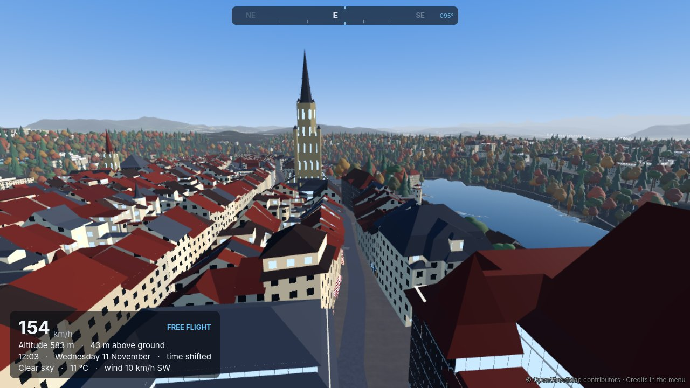 | 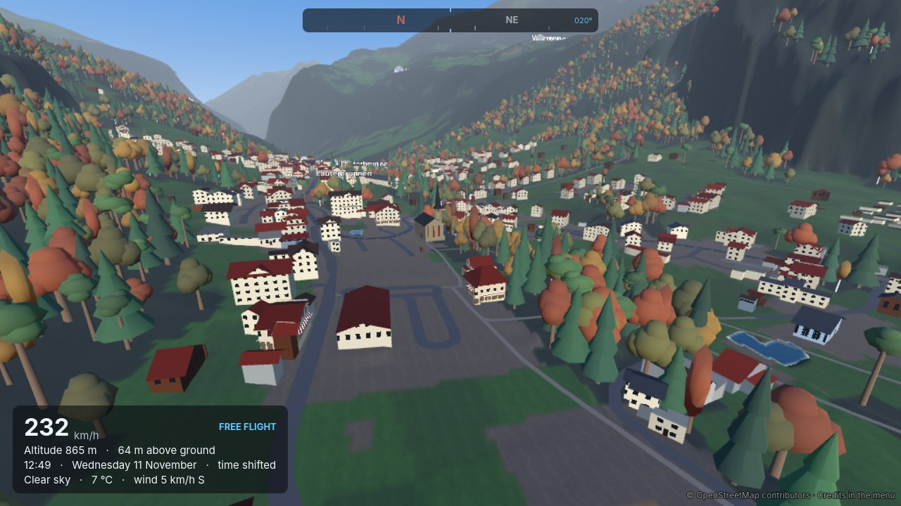 | 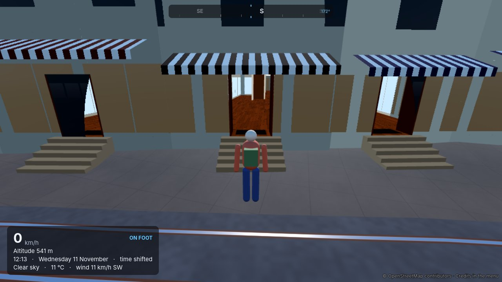 |

### Fonction des bâtiments et intérieurs

Chaque bâtiment reçoit une **fonction réelle** (`scripts/Buildings/BuildingKind.cs`), d'après, dans l'ordre :
la classe OSM transmise par Overture (`building=church`, `school`, `retail`, `stadium`…), les **lieux Overture Places**
situés dans son contour (magasins, restaurants, écoles, hôpitaux, églises… `places.pmtiles`, licence CDLA Permissive 2.0,
usage commercial autorisé), son nom (« Kirche », « école », « Stadion »…), la zone OSM qui le contient (enceinte d'école,
d'hôpital, de stade : `base.pmtiles`, couche `land_use`) et enfin le sous-type Overture et la taille.

La fonction décide de l'aspect : **clocher** (tour et flèche à l'ouest de la nef) pour les églises, clocheton pour les
chapelles, **coupole et minaret** pour les mosquées, coupoles des toits `dome`, **vitrines éclairées, auvents rayés et
enseignes** (nom du commerce au-dessus de la porte) au rez-de-chaussée des magasins, grandes baies des écoles,
bandeaux vitrés des bureaux, murs-rideaux des tours, vitraux des églises, fenêtres hautes des halles, **gradins colorés
et pelouse tracée** des stades, serres vitrées, couleurs de façade par fonction. Les fenêtres sont alignées sur les vrais
étages de l'intérieur.

**On peut entrer dans les bâtiments** (sauf garages, cabanes, abris, réservoirs, serres et stades) :

- la porte est sur une façade qui donne dehors (pas sur un mur mitoyen), le plus près du niveau de la rue ; elle s'ouvre
  toute seule à moins de 7 m (le shader des façades l'efface et l'intérieur dessine le battant ouvert) ; des marches
  mènent au rez-de-chaussée s'il est au-dessus du trottoir ;
- `scripts/Buildings/InteriorBuilder.cs` génère l'intérieur (toujours le même pour un bâtiment donné) : une dalle par
  étage (`building:levels` d'OSM, sinon d'après la hauteur), une **cage d'escalier à deux volées** par étage avec
  garde-corps, des pièces obtenues par découpage du plan, séparées par des cloisons percées de portes, et du **mobilier
  selon la fonction** : bancs et autel d'église, pupitres et tableau noir d'école, rayons et caisse de magasin,
  supermarché, tables de restaurant, lits d'hôpital, bureaux, séjour / chambres / cuisine des appartements, chambres
  d'hôtel et accueil, bibliothèques, socles et tableaux de musée, rayonnages d'entrepôt, bancs de gare, terrain et
  paniers de la salle de sport ;
- les nefs, halles, gares, entrepôts et supermarchés sont d'un seul tenant ; dans les immeubles, seuls les étages autour
  du joueur sont meublés (refaits quand il change d'étage) ; **ascenseur** PgUp / PgDn dès 5 niveaux ;
- collisions complètes : planchers et plafonds (on s'y cogne la tête), volées d'escalier (rampes), murs, cloisons,
  meubles ; le toit reste praticable. La caméra se rapproche à l'intérieur ;
- `scripts/Buildings/BuildingInteriors.cs` gère les intérieurs autour du joueur selon le niveau de qualité :

| | Bas | Moyen | Élevé | Ultra |
|---|---|---|---|---|
| Intérieurs générés jusqu'à | 25 m (6 au plus) | 45 m (12) | 80 m (24) | 140 m (40) |
| Mobilier | aucun | gros meubles | complet | complet + plantes, écrans, plafonniers |
| Étages meublés autour du joueur | le sien | ± 1 | ± 1 | ± 2 |
| Enseignes des commerces jusqu'à | 40 m | 80 m | 140 m | 220 m |

Tests : `-- --build=46.948,7.451,500 --enter=church --shot=f.png` place le personnage devant la porte de l'église la
plus proche (`school`, `shop`, `tall`, `any`…) ; `--stairs` le met au pied de l'escalier, et `--walktest=N` le fait
avancer (il monte).

Pistes suivantes : collisions avec les murs en mode marche ; pas d'arbres à l'intérieur des bâtiments ;
textures de façades.

## Personnage

Personnage 3D stylisé (homme ou femme, 6 personnages prêts, tout modifiable avec **U**), ~90 animations, vêtements
modernes générés par le jeu et tenue qui suit l'activité (vélo, avion, bateau, nage). Modèles et animations :
Quaternius, CC0. Détails : [`docs/PERSONNAGE.md`](docs/PERSONNAGE.md).

## Données (toutes gratuites)

| Fichier | Source | Résolution |
|---|---|---|
| `data/world_base.hgt.gz` | Tuiles Terrarium (AWS Open Data : SRTM, GMTED, ETOPO1…), avec bathymétrie | ~5 km |
| Relief mondial (streaming) | Copernicus DEM GLO-30, bucket AWS `copernicus-dem-30m` | 30 m |
| Eau et couverture des sols (streaming) | ESA WorldCover 2021, bucket AWS `esa-worldcover` (CC BY 4.0) | 10 m |
| `data/landcover/world_cover.bin.gz` | ESA WorldCover 2021 © ESA WorldCover project / Copernicus Sentinel data 2021, CC BY 4.0 | ~5 km |
| `data/detail/*.hgt.gz` | Copernicus DEM GLO-30 © DLR e.V. 2010-2014 et © Airbus 2014-2018, fourni par l'ESA | 30 m |
| `data/detail/*.wat.gz` | ESA WorldCover 2021 (classe « eau ») © ESA | 10 m → 30 m |
| Relief Suisse (streaming) | swissALTI3D © swisstopo (données ouvertes OGD, usage commercial autorisé avec mention de la source) | 0,5 m |
| `data/nightlights/nightlights.bin.gz` | NASA Earth Observatory, Black Marble 2016 (Suomi NPP VIIRS), domaine public | ~5 km |
| `data/swissalti3d_index.bin` | index des tuiles swissALTI3D (API STAC de data.geo.admin.ch), `tools/swissalti3d/build_index.py` | 1 km |
| Météo | NOAA GFS (domaine public), via AWS Open Data | 1°, toutes les 3 h |
| `data/geo/*` | Natural Earth 1:10m (domaine public) | ~1 km |
| `data/timezones/timezones.bin.gz` | timezone-boundary-builder, © contributeurs OpenStreetMap, licence ODbL | 0,025° |
| Bâtiments (streaming, à la demande) | Overture Maps buildings : © contributeurs OpenStreetMap (ODbL), Microsoft ML Buildings (ODbL), Google Open Buildings (CC BY 4.0), USGS (domaine public) | tuiles z14 |
| Bâtiments en Suisse (streaming, à la demande) | swissBUILDINGS3D 3.0 © swisstopo (OGD, usage commercial autorisé) | tuiles z14 (release `swissbuildings3d`) |
| Arrêts, gares, ports (streaming) | OpenStreetMap via Overture Maps, archive `base` (même licence ODbL) | tuiles z13 (~5 km) |
| `data/geo/localities.tsv.br` | Localités OpenStreetMap via Overture Maps « divisions » (ODbL) | 1,7 million de villes et villages |
| `data/transport/airports.tsv.gz` | OurAirports (domaine public) | — |
| `assets/characters/quaternius/` | Quaternius : Universal Base Characters, Universal Animation Library 1 et 2 (CC0) | — |
| Horaires suisses (release `timetable-latest`) | opentransportdata.swiss, GTFS (usage libre, mention de la source obligatoire) | toutes les courses de l'année |
| Routes, chemins, rails, localités (streaming) | OpenStreetMap via Overture Maps (bucket AWS `overturemaps-extras-us-west-2`), © contributeurs OpenStreetMap, licence ODbL | tuiles z14 (~2,4 km) |

Le relief 30 m couvre toute la Terre en streaming (connexion Internet nécessaire la première fois ; ensuite le cache suffit).
Les tuiles locales `data/detail/` (45–48°N, 5–11°E) servent de version hors ligne pour la Suisse.

### Ajouter une région

```bash
pip install rasterio numpy pillow
cd tools/pipeline
python build_detail_tiles.py ../../data/detail LAT_MIN LAT_MAX LON_MIN LON_MAX
# ex. la Corse : python build_detail_tiles.py ../../data/detail 41 43 8 10
```

Ce n'est plus nécessaire pour avoir du 30 m (le streaming couvre la Terre), seulement pour jouer hors ligne
sur une région. Chaque tuile pèse ~8 Mo.

Format des fichiers : en-tête 16 octets (`SEH1`, largeur, hauteur, 0) puis int16 codés en delta par ligne, le tout en gzip.

### Export du jeu

Les fichiers `.gz` ne sont pas des ressources Godot : dans *Projet → Exporter → Ressources*, ajouter
`data/*` dans « Filtres pour exporter des fichiers non-ressources ».

## Limites connues / prochaines étapes

- Relief plus fin que 30 m : pays par pays (Suisse 0,5 m avec swissALTI3D, France 1 m avec le RGE ALTI…).
- Copernicus n'a pas de fichier pour l'Arménie et l'Azerbaïdjan (relief à ~5 km là-bas pour l'instant).
- Transports : tracés réels des lignes suisses, retards en direct, puis autres pays selon la ville de départ des
  joueurs (GTFS : transport.data.gouv.fr pour la France…, licence à vérifier flux par flux pour un jeu vendu). Avions : OurAirports + lignes aériennes à reconstituer (pas de source gratuite
  d'horaires mondiaux utilisable commercialement ; OpenSky est réservé au non commercial).
- Océan = surface plate colorée → shader d'eau, vagues, physique de flottaison.
- Atmosphère : ciel procédural Godot → diffusion atmosphérique vue de l'espace.
- Collisions physiques pour les véhicules (colliders générés pour les chunks proches).
- Rivières plus fines (OpenStreetMap / HydroRIVERS).
- Routes : rubans posés sur le relief, sans aplanir le terrain ni collisions pour les véhicules ; noms de rues pas encore affichés.
